<div align="center">

# 🧾 Fiş Takip

**Fişini okut, harcamanı otomatik takip et.**

Fişin fotoğrafını çekip içindeki ürünleri, tutarları ve KDV'yi otomatik ayrıştıran, harcamaları günlük, haftalık ve aylık raporlayan bir Flutter muhasebe uygulaması.


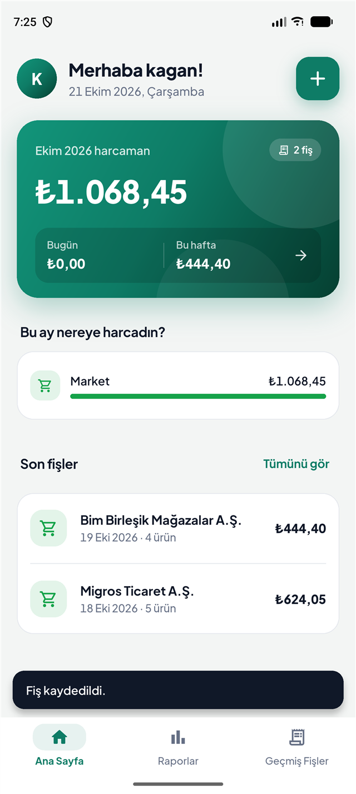 &nbsp;
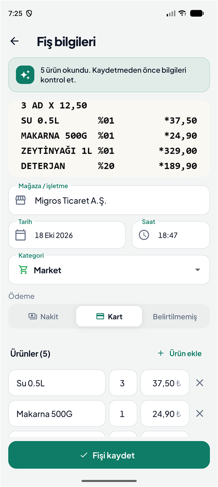 &nbsp;
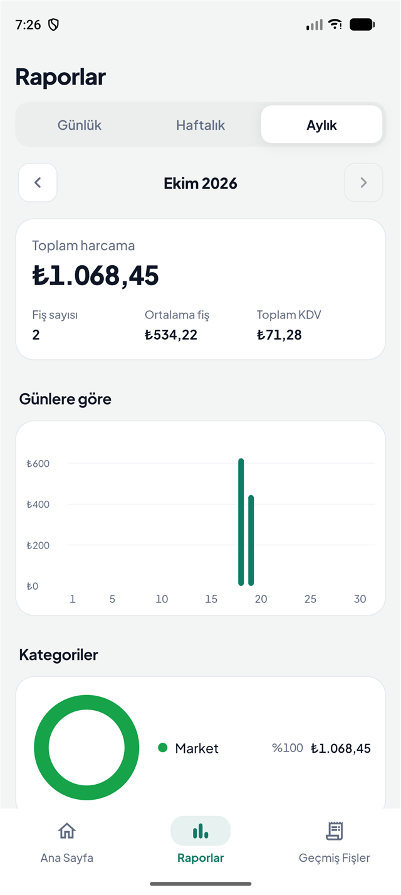

</div>

---

## 📑 İçindekiler

1. [Projenin amacı](#-projenin-amacı)
2. [Özellikler](#-özellikler)
3. [Ekran görüntüleri](#-ekran-görüntüleri)
4. [Kullanıcı akışı](#-kullanıcı-akışı)
5. [Fiş okuma nasıl çalışıyor?](#-fiş-okuma-nasıl-çalışıyor)
6. [Raporlama](#-raporlama)
7. [Giriş, kayıt ve şifre sıfırlama](#-giriş-kayıt-ve-şifre-sıfırlama)
8. [Veritabanı ve JSON görünümü](#-veritabanı-ve-json-görünümü)
9. [Mimari](#-mimari)
10. [Geliştirme ve test ortamı (emülatör)](#-geliştirme-ve-test-ortamı)
11. [Kullanılan paketler ve sürümleri](#-kullanılan-paketler-ve-sürümleri)
12. [Dosyalar](#-dosyalar)
13. [Widget'lar](#-widgetlar)
14. [Sınıflar ve fonksiyonlar](#-sınıflar-ve-fonksiyonlar)
15. [Testler](#-testler)
16. [Karşılaşılan sorunlar ve çözümler](#-karşılaşılan-sorunlar-ve-çözümler)
17. [Kurulum ve çalıştırma](#-kurulum-ve-çalıştırma)
18. [Sunum için demo senaryosu](#-sunum-için-demo-senaryosu)
19. [Sınırlamalar ve geliştirme fikirleri](#-sınırlamalar-ve-geliştirme-fikirleri)

---

## 🎯 Projenin amacı

Market, akaryakıt ve kafe gibi yerlerden aldığımız fişler genellikle cüzdanda kaybolur ve ay sonunda paranın nereye gittiği bilinmez. Fişleri tek tek elle deftere veya Excel'e yazmak da zahmetlidir.

**Fiş Takip** bu süreci otomatikleştirir:

1. Kullanıcı **+** butonuna basar ve fişin fotoğrafını çeker.
2. Uygulama fişteki yazıyı **cihazın üzerinde, internet olmadan** okur.
3. Mağazayı, tarihi, ürünleri, adetleri, KDV'yi ve toplamı **otomatik ayırır**.
4. Harcamalar **günlük, haftalık ve aylık raporlara** kategori, mağaza ve ürün bazında işlenir.

---

## ✨ Özellikler

| Alan | Özellik |
|---|---|
| 👤 **Hesap** | Kayıt ol, giriş yap, **Beni hatırla**, **Şifremi unuttum** (6 haneli doğrulama kodu ile) |
| 🏠 **Ana sayfa** | "Merhaba *kullanıcı adı*!" karşılaması, sağ üstte **+** butonu, aylık, haftalık ve günlük özet, kategori dağılımı, son fişler |
| 📷 **Fiş ekleme** | Kamerayla tara · Galeriden seç · Fiş metnini yapıştır · Elle gir |
| 🤖 **Akıllı ayrıştırma** | Mağaza, tarih/saat, fiş no, ürünler, adet (`3 AD X 12,50`), KDV, toplam, ödeme tipi, otomatik **kategori** tahmini |
| ✏️ **Kontrol ekranı** | Okunan her bilgi kaydetmeden önce düzenlenebilir. Ürünlerin toplamı fiş toplamını tutmazsa uyarı çıkar |
| 📊 **Raporlar** | Günlük, haftalık ve aylık dönemler, önceki dönemle karşılaştırma, grafik, kategori pastası, **ürün bazında döküm**, mağazalar |
| 🗂️ **Geçmiş fişler** | Aylara göre gruplama, mağaza veya ürün adıyla arama, kategori filtresi, kaydırarak silme, detay ve düzenleme |
| 🗄️ **Veritabanı görünümü** | Tüm veriler JSON olarak hem uygulama içinde görüntülenir hem telefonda dosyaya yazılır |
| 🎨 **Tasarım** | Material 3, özel renk paleti, Plus Jakarta Sans fontu, açık/koyu tema, Türkçe tarih ve para formatı |

---

## 📱 Ekran görüntüleri

> Tüm görüntüler Android emülatöründe (Pixel 10 Pro) uygulamanın kendisinden alınmıştır.

| Giriş | Şifremi unuttum (doğrulama kodu) | Ana sayfa |
|:---:|:---:|:---:|
| 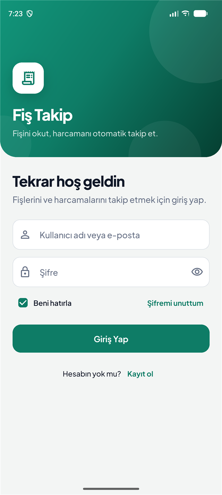 | 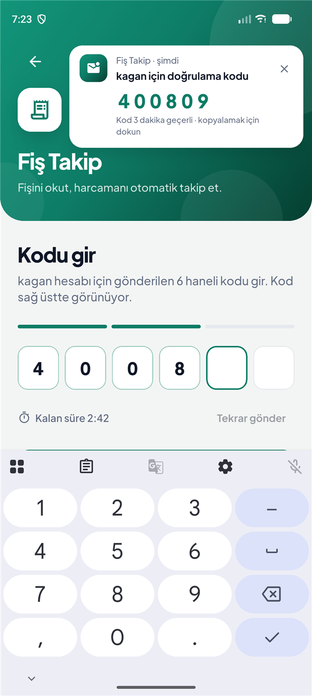 |  |
| **Beni hatırla** ve **Şifremi unuttum** | E-posta servisi yerine kod **sağ üstte bildirim** olarak gelir | "Merhaba kagan!" ve sağ üstte **+** |

| Fiş ekleme (+) | Fotoğraftan okunan fiş | Aylık rapor |
|:---:|:---:|:---:|
| 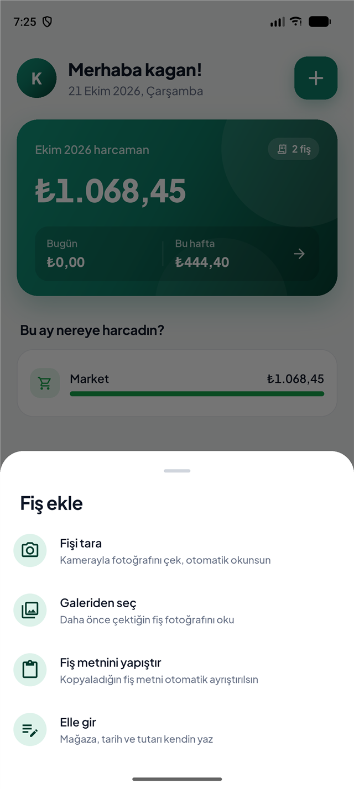 |  |  |
| 4 farklı ekleme yöntemi | ML Kit ile okunan 5 ürün, adet, kategori ve ödeme | Toplam, ortalama, KDV ve günlük grafik |

| Ürün bazında rapor | Geçmiş fişler | Fiş detayı |
|:---:|:---:|:---:|
| 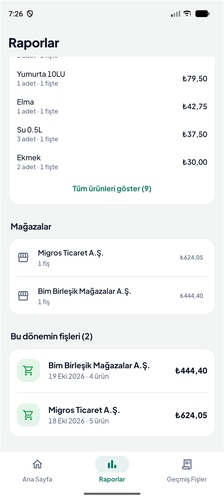 | 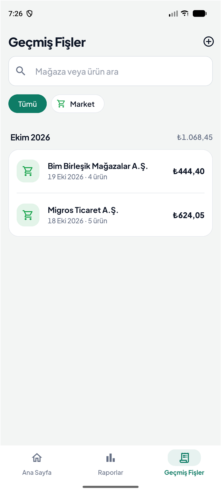 | 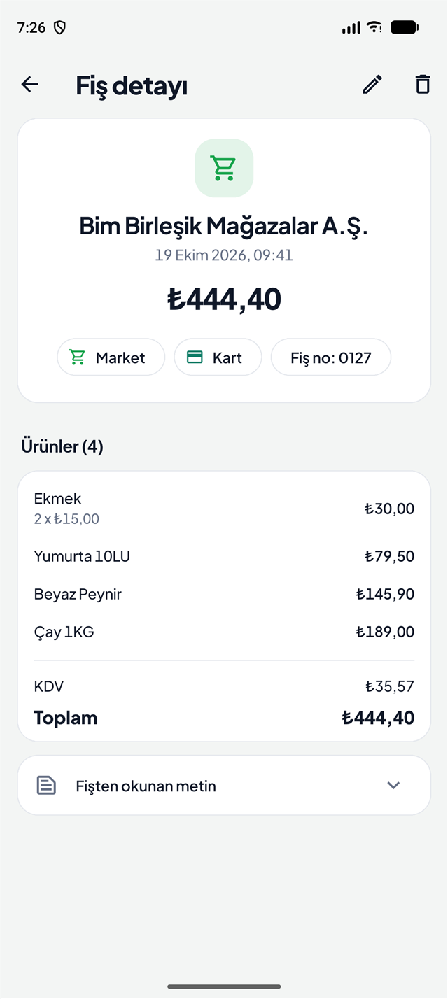 |
| Fişlerden ayrıştırılan ürünlerin dökümü | Arama ve kategori filtresi | Ürünler, birim fiyat, KDV, toplam |

| Veritabanı (JSON) |
|:---:|
| 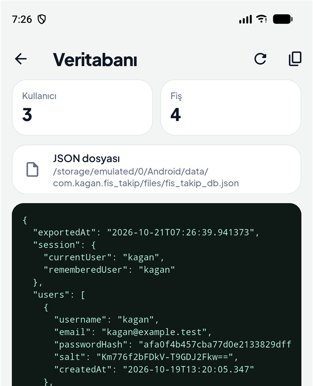 |
| Uygulama içinden veritabanının JSON hâli |

---

## 🔀 Kullanıcı akışı

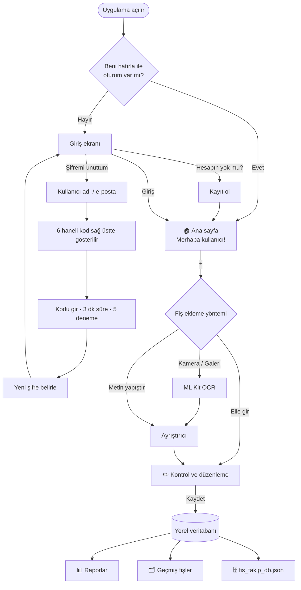

---

## 🤖 Fiş okuma nasıl çalışıyor?

Okuma, **4 adımlı bir hattan** geçer:

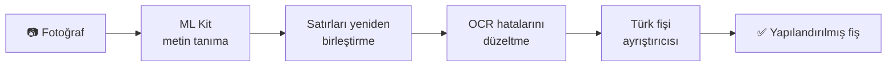

**1. Metin tanıma:** Google ML Kit, fotoğraftaki yazıyı **cihazın üzerinde** okur. İnternet ya da ücretli bir API gerekmez.

**2. Satırları yeniden birleştirme** (`platform_services_io.dart`): ML Kit, fişteki ürün adı sütununu ve fiyat sütununu çoğu zaman **ayrı bloklar** olarak döndürür. Her parçanın ekrandaki dikey konumuna bakılır, aynı hizadakiler birleştirilir ve böylece `EKMEK   *7,50` gibi gerçek fiş satırları elde edilir.

**3. OCR hatalarını düzeltme** (`receipt_parser.dart`): Emülatördeki testlerde ML Kit'in tipik hatalar yaptığı görüldü:

| OCR'ın okuduğu | Gerçeği | Düzeltme kuralı |
|---|---|---|
| `*624,O5` | `*624,05` | Rakamların arasındaki **O harfi → 0** |
| `%O1` | `%01` | `%` işaretinden sonraki O → 0 |
| `*37, 50` | `*37,50` | Ayırıcıdan sonraki boşluk silinir |
| `*24,9` | `*24,90` | `*` ile başlayan tek haneli kuruş tamamlanır |
| `MÍGROS TỈCARET` | `MİGROS TİCARET` | Benzer görünen yabancı harfler (Í, Ỉ, Ő…) Türkçe harfe çevrilir |

> `NO.0045` gibi harften sonra gelen O'lara dokunulmaz. Bu durum için ayrı bir birim testi var.

**4. Türk fişi ayrıştırıcısı:** ÖKC (yazar kasa) fişlerinin düzenine göre şu bilgileri çıkarır:

| Bilgi | Nasıl bulunur? |
|---|---|
| Mağaza | İlk anlamlı satır. Adres, telefon, VKN gibi satırlar atlanır |
| Tarih / saat | `18.10.2026`, `19/10/26`, `SAAT: 18:47` gibi biçimler |
| Ürünler | Sonunda tutar olan satırlar. `TOPLAM`, `KDV`, `NAKİT` gibi kelimeler **tam kelime** olarak elenir, böylece "**KART**ON BARDAK" yanlışlıkla elenmez |
| Adet | Ürünün üstündeki `3 AD X 12,50` veya `0,750 KG X 40,00` satırı |
| Toplam / KDV | `TOPLAM`, `GENEL TOPLAM`, `TOPKDV`. Toplam bulunamazsa ürünlerden hesaplanır |
| İndirim | `İNDİRİM -5,00` negatif kalem olarak eklenir |
| Kategori | Mağaza adındaki anahtar kelimeler: Migros/BİM/ŞOK → Market, Opet/Shell → Akaryakıt, Eczane → Sağlık… |

**Örnek:** Emülatörde okutulan fişin sonucu.

| Fişte yazan | Uygulamanın çıkardığı |
|---|---|
| `MİGROS TİCARET A.Ş.` | Mağaza: **Migros Ticaret A.Ş.** · Kategori: **Market** |
| `TARİH: 18.10.2026  SAAT: 18:47` | Tarih: **18 Ekim 2026, 18:47** |
| `3 AD X 12,50` + `SU 0.5L %01 *37,50` | **Su 0.5L** · 3 adet · ₺37,50 |
| `TOPKDV *35,71` / `TOPLAM *624,05` | KDV **₺35,71** · Toplam **₺624,05** |
| `KREDİ KARTI` | Ödeme: **Kart** |

---

## 📊 Raporlama

`report_service.dart`, kaydedilen fişlerden seçilen dönem için şu raporu üretir:

- **Dönemler:** Günlük (00:00–24:00), Haftalık (pazartesi başlangıçlı), Aylık. Oklarla önceki ve sonraki döneme geçilebilir.
- **Özet:** Toplam harcama, fiş sayısı, ortalama fiş tutarı, toplam KDV ve **önceki döneme göre % değişim**.
- **Grafik:** Günlük raporda 3 saatlik dilimler, haftalıkta haftanın günleri, aylıkta ayın günleri.
- **Kategoriler:** Halka grafik ve yüzdeler.
- **Ürünler:** Fişlerden ayrıştırılan kalemler **birleştirilir**. Örneğin iki ayrı fişteki "Ekmek" tek satırda toplam adet ve tutarla gösterilir.
- **Mağazalar** ve **dönemin fişleri**.

---

## 🔐 Giriş, kayıt ve şifre sıfırlama

| Özellik | Nasıl çalışıyor? |
|---|---|
| **Şifre saklama** | Şifreler düz metin olarak **saklanmaz**. Her kullanıcıya rastgele bir **salt** üretilir ve `SHA-256(salt + şifre)` kaydedilir |
| **Beni hatırla** | İşaretliyse oturum uygulama kapanıp açılınca da sürer ve kullanıcı adı giriş ekranında hazır gelir. İşaretli değilse oturum yalnızca o kullanım süresince açık kalır |
| **Şifremi unuttum** | 1) Kullanıcı adı veya e-posta girilir. 2) `Random.secure()` ile **6 haneli kod** üretilir. 3) Kod girilir. 4) Yeni şifre belirlenir |
| **Kodun gösterimi** | Projede e-posta servisi olmadığı için kod, **ekranın sağ üstünde gelen bir bildirim gibi** gösterilir. Bildirime dokununca kod kopyalanır |
| **Kod güvenliği** | Kod **3 dakika** geçerlidir ve en fazla **5 hatalı deneme** yapılabilir. Yeni kod 30 saniye sonra istenebilir. Ekrandan çıkılınca kod geçersiz olur |

---

## 💾 Veritabanı ve JSON görünümü

Veriler cihazda **Hive** ile saklanır: Android'de dosyada, web'de tarayıcının IndexedDB'sinde. Üç tablo (kutu) vardır:

| Kutu | Anahtar | İçerik |
|---|---|---|
| `users` | küçük harf kullanıcı adı | kullanıcı adı, e-posta, şifre özeti, salt, kayıt tarihi |
| `receipts` | fiş id | sahibi, mağaza, tarih, kategori, **ürünler listesi**, toplam, KDV, ödeme, fiş no, görsel yolu, okunan ham metin |
| `session` | `current`, `remembered` | açık oturum ve hatırlanan kullanıcı |

**Veritabanını görmenin 4 yolu:**

1. **Proje klasöründen (editörde canlı):** Uygulama emülatörde açıkken şu komutu çalıştır:
   ```bash
   dart run tool/db_cek.dart --izle
   ```
   Veritabanı `database/fis_takip_db.json` dosyasına kopyalanır. Uygulamada fiş ekledikçe veya sildikçe dosya **2 saniye içinde kendiliğinden güncellenir**, VS Code'da açık tutman yeterli. Tek seferlik kopyalamak için `--izle` yazmadan çalıştır.
   > `database/` klasörü `.gitignore`'dadır. Gerçek kullanıcı verileri repoya gönderilmez.
2. **Uygulama içinden:** Ana sayfada avatar → **Veritabanı (JSON)**. Yenileme ve kopyalama düğmeleri vardır, web'de de çalışır.
3. **Telefondaki dosya:** Her değişiklikte otomatik güncellenir:
   ```
   /sdcard/Android/data/com.kagan.fis_takip/files/fis_takip_db.json
   ```
4. **Repodaki örnek:** [`docs/database_ornek.json`](docs/database_ornek.json)

<details>
<summary><b>Örnek JSON'u göster</b> (kısaltılmış)</summary>

```json
{
  "exportedAt": "2026-10-21T07:26:39.942349",
  "session": { "currentUser": "kagan", "rememberedUser": "kagan" },
  "users": [
    {
      "username": "kagan",
      "email": "kagan@example.test",
      "passwordHash": "afa0f4b457cba77d0e2133829dff4830baf0f4fe026c8d6b7303a788f174d2bf",
      "salt": "Km776f2bFDkV-T9GDJ2Fkw==",
      "createdAt": "2026-10-19T13:20:05.347"
    }
  ],
  "receipts": [
    {
      "id": "1792567507141544817e",
      "owner": "kagan",
      "storeName": "Bim Birleşik Mağazalar A.Ş.",
      "date": "2026-10-19T09:41:00.000",
      "category": "market",
      "items": [
        { "name": "Ekmek", "quantity": 2.0, "total": 30.0 },
        { "name": "Yumurta 10LU", "quantity": 1.0, "total": 79.5 },
        { "name": "Beyaz Peynir", "quantity": 1.0, "total": 145.9 },
        { "name": "Çay 1KG", "quantity": 1.0, "total": 189.0 }
      ],
      "total": 444.4,
      "vat": 35.57,
      "paymentMethod": "Kart",
      "receiptNo": "0127"
    }
  ]
}
```
</details>

---

## 🏢 Mimari

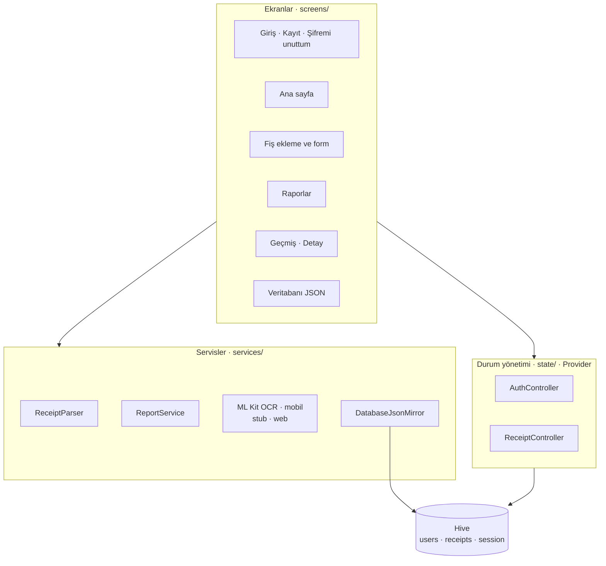

```
lib/
├── main.dart                     Uygulama girişi, Provider kurulumu
├── theme.dart                    Renk paleti, tipografi, bileşen temaları
├── data/app_database.dart        Hive kutuları
├── models/                       AppUser · Receipt · ReceiptItem · ExpenseCategory
├── state/                        AuthController · ReceiptController
├── services/
│   ├── receipt_parser.dart       Fiş metni → yapılandırılmış veri
│   ├── report_service.dart       Dönem hesapları ve rapor özetleri
│   ├── db_export.dart            Veritabanı → JSON
│   └── platform/                 ML Kit OCR ve dosya işlemleri (mobil) / boş uygulama (web)
├── screens/
│   ├── auth/                     Giriş · Kayıt · Şifremi unuttum
│   ├── home/                     Alt menü · Ana sayfa · Veritabanı
│   ├── receipts/                 Ekleme akışı · Form · Detay · Geçmiş
│   └── reports/                  Raporlar
├── widgets/                      Ortak bileşenler · kayan sekmeler · kod girişi ve bildirimi
└── utils/                        Türkçe metin ve para/tarih biçimlendirme
test/receipt_parser_test.dart     Ayrıştırıcı birim testleri
tool/db_cek.dart                  Cihazdaki veritabanını database/ klasörüne çeker
```

**Tasarım kararları:**
- **Koşullu import:** `platform_services.dart`, mobilde ML Kit'li sürümü, web'de boş sürümü yükler. Böylece aynı kod iki platformda da derlenir.
- **Ayrıştırıcı saf Dart:** Flutter'a veya cihaza bağımlı olmadığı için birim testlerle doğrulanabilir.
- **Kullanıcıya göre veri:** Her fişin `owner` alanı vardır ve her kullanıcı yalnızca kendi fişlerini görür.

---

## 💻 Geliştirme ve test ortamı

### Android emülatörü

Uygulama ve README'deki tüm ekran görüntüleri bu sanal cihazda test edildi:

| Özellik | Değer |
|---|---|
| AVD adı | `Pixel_10_Pro` (cihaz profili: **Google Pixel 10 Pro**) |
| Android sürümü | **Android 17** (API seviyesi **37**, build `CP41.260831.007`) |
| Sistem görüntüsü | Google APIs **Play Store**, 16 KB sayfa boyutu (`android-37.2 / google_apis_playstore_ps16k`) |
| İşlemci mimarisi | `x86_64` |
| Ekran | 1280 × 2856 piksel, 480 dpi |
| RAM / depolama | 2 GB RAM, 10 GB veri bölümü |
| Grafik | GPU modu `auto` (donanım hızlandırmalı) |
| Emülatör sürümü | Android Emulator **37.2.12.0** |

> Kameralı testlerde emülatörün sanal sahnesi kullanılır. Gerçekçi bir OCR testi için oluşturulan fiş görseli emülatörün galerisine yüklenip *Galeriden seç* ile okutuldu.

### Araçlar ve derleme ayarları

| Araç | Sürüm |
|---|---|
| İşletim sistemi | Windows 11 Pro |
| Flutter | **3.47.5** (stable kanal) |
| Dart | **3.13.4** |
| DevTools | 2.60.0 |
| Android Gradle Plugin | 9.1.0 |
| Gradle | 9.3.1 |
| Kotlin | 2.4.0 |
| JDK | OpenJDK 25 (Android Studio JBR), Java hedefi 17 |
| Android NDK | 28.2.13676358 |
| CMake | 3.22.1 |
| `compileSdk` / `targetSdk` | 36 / 36 |
| `minSdk` | **24** (Android 7.0 ve üzeri) |
| Uygulama kimliği | `com.kagan.fis_takip` · sürüm 1.0.0 (1) |
| APK mimarileri | `arm64-v8a`, `armeabi-v7a`, `x86_64` |
| Web testi | Google Chrome 155 |

---

## 📦 Kullanılan paketler ve sürümleri

| Paket | Sürüm | Ne için? |
|---|---|---|
| `google_mlkit_text_recognition` | 0.17.1 | Cihaz üzerinde, internetsiz metin tanıma (OCR) |
| `image_picker` | 1.2.4 | Kamera ve galeriden fotoğraf seçme |
| `hive_ce` | 2.22.0 | Hızlı, yerel NoSQL veritabanı |
| `hive_ce_flutter` | 2.5.0 | Hive'ın Flutter entegrasyonu (Android dosyası, web IndexedDB) |
| `provider` | 6.1.5+1 | Durum yönetimi (`ChangeNotifier`) |
| `fl_chart` | 1.2.0 | Çubuk ve halka grafikler |
| `crypto` | 3.0.7 | Şifre özeti (SHA-256) |
| `intl` | 0.20.3 | Türkçe tarih (`18 Ekim 2026`) ve para (`₺1.068,45`) biçimi |
| `flutter_localizations` | SDK | Takvim ve saat seçicilerin Türkçe olması |
| `path_provider` | 2.1.6 | Fiş görselleri ve JSON dosyası için klasörler |
| `cupertino_icons` | 1.0.9 | İkon seti |
| `flutter_lints` *(geliştirme)* | 6.0.0 | Kod kalite kuralları |
| `flutter_test` *(geliştirme)* | SDK | Birim testleri |
| **Plus Jakarta Sans** | 400–800 | Türkçe karakter destekli font, `assets/fonts` içine gömülü |

---

## 📂 Dosyalar

Proje **34 Dart dosyası** ve **5.499 satır** koddan oluşur: 32 uygulama dosyası, 1 test dosyası ve 1 araç betiği.

| Dosya | Satır | Görevi |
|---|---:|---|
| **Giriş ve tema** | | |
| `lib/main.dart` | 60 | Uygulamayı başlatır: Türkçe tarih verisi, veritabanını açma, Provider'lar, giriş yapılmışsa ana sayfa yoksa giriş ekranı |
| `lib/theme.dart` | 256 | Renk paleti, açık/koyu tema, font, buton, kart, form ve alt menü stilleri |
| **Veri ve modeller** | | |
| `lib/data/app_database.dart` | 24 | Hive'ı başlatır, `users`, `receipts` ve `session` kutularını açar |
| `lib/models/app_user.dart` | 31 | Kullanıcı modeli (ad, e-posta, şifre özeti, salt) |
| `lib/models/receipt.dart` | 90 | Fiş (`Receipt`) ve fiş kalemi (`ReceiptItem`) modelleri |
| `lib/models/expense_category.dart` | 123 | 9 harcama kategorisi (ikon, renk, anahtar kelimeler) ve kategori tahmini |
| **Durum yönetimi** | | |
| `lib/state/auth_controller.dart` | 175 | Kayıt, giriş, çıkış, Beni hatırla, doğrulama kodu ve şifre sıfırlama |
| `lib/state/receipt_controller.dart` | 64 | Giriş yapan kullanıcının fişlerini yükler, kaydeder, siler |
| **Servisler** | | |
| `lib/services/receipt_parser.dart` | 336 | OCR metnini temizler ve Türk fişini ayrıştırır |
| `lib/services/report_service.dart` | 193 | Günlük, haftalık ve aylık dönem hesapları ve rapor özetleri |
| `lib/services/db_export.dart` | 66 | Veritabanını JSON'a çevirir ve dosyaya yansıtır |
| `lib/services/platform/platform_services.dart` | 5 | Mobilde ve web'de doğru uygulamayı seçen koşullu export |
| `lib/services/platform/platform_services_io.dart` | 85 | Mobil: ML Kit OCR, satır birleştirme, görsel ve JSON dosyası |
| `lib/services/platform/platform_services_stub.dart` | 16 | Web: OCR ve dosya işlemlerinin boş karşılıkları |
| **Ekranlar** | | |
| `lib/screens/auth/auth_layout.dart` | 196 | Giriş ekranlarının ortak iskeleti (gradyanlı başlık) ve şifre alanı |
| `lib/screens/auth/login_screen.dart` | 177 | Giriş ekranı, Beni hatırla, Şifremi unuttum bağlantısı |
| `lib/screens/auth/register_screen.dart` | 132 | Kayıt ekranı ve form doğrulama |
| `lib/screens/auth/forgot_password_screen.dart` | 337 | 3 adımlı şifre sıfırlama (kullanıcı adı → kod → yeni şifre) |
| `lib/screens/home/home_shell.dart` | 68 | Alt menü (Ana Sayfa · Raporlar · Geçmiş Fişler) |
| `lib/screens/home/dashboard_screen.dart` | 426 | "Merhaba kullanıcı!", **+** butonu, özet kartı, kategoriler, son fişler |
| `lib/screens/home/database_screen.dart` | 129 | Veritabanının JSON görünümü |
| `lib/screens/receipts/add_receipt_flow.dart` | 221 | **+** menüsü, kamera/galeri/metin/elle ekleme akışı |
| `lib/screens/receipts/receipt_form_screen.dart` | 529 | Okunan fişi kontrol etme ve düzenleme formu |
| `lib/screens/receipts/receipt_detail_screen.dart` | 216 | Fiş detayı, düzenleme ve silme |
| `lib/screens/receipts/history_screen.dart` | 177 | Geçmiş fişler: arama, filtre, aylara göre gruplama |
| `lib/screens/receipts/image_viewer.dart` | 23 | Fiş görselini tam ekran ve yakınlaştırılabilir açar |
| `lib/screens/reports/reports_screen.dart` | 491 | Raporlar ekranı ve grafikler |
| **Ortak bileşenler ve yardımcılar** | | |
| `lib/widgets/common.dart` | 153 | Fiş satırı, kategori ikonu, bölüm başlığı, boş durum, kart listesi |
| `lib/widgets/pill_tabs.dart` | 125 | Kayan sekme seçici |
| `lib/widgets/otp_widgets.dart` | 286 | Sağ üstte çıkan kod bildirimi ve 6 kutulu kod girişi |
| `lib/utils/format.dart` | 41 | Para, tarih ve sayı biçimlendirme |
| `lib/utils/text_utils.dart` | 38 | Türkçeye uygun büyük/küçük harf dönüşümleri |
| **Test ve araç** | | |
| `test/receipt_parser_test.dart` | 130 | Ayrıştırıcının 6 birim testi |
| `tool/db_cek.dart` | 80 | Emülatördeki veritabanını `database/` klasörüne çeker |

**Diğer dosyalar:**

| Dosya | Görevi |
|---|---|
| `pubspec.yaml` | Paketler ve font tanımları |
| `assets/fonts/PlusJakartaSans-*.ttf` | 5 kalınlıkta gömülü font |
| `android/app/build.gradle.kts` | Android derleme ayarları |
| `android/app/src/main/AndroidManifest.xml` | Uygulama adı ("Fiş Takip") ve izinler |
| `docs/screenshots/*.png` | README'deki 10 ekran görüntüsü |
| `docs/database_ornek.json` | Örnek veritabanı içeriği |

---

## 🧱 Widget'lar

### Projede yazılan widget'lar

| Widget | Tür | Dosya | Görevi |
|---|---|---|---|
| `FisTakipApp` | Stateless | `main.dart` | `MaterialApp`, tema, Türkçe yerelleştirme, giriş durumuna göre ilk ekran |
| `AuthLayout` | Stateless | `auth_layout.dart` | Giriş, kayıt ve şifre sıfırlamanın ortak iskeleti |
| `PasswordField` | Stateful | `auth_layout.dart` | Göster/gizle butonlu şifre alanı |
| `LoginScreen` | Stateful | `login_screen.dart` | Giriş formu, Beni hatırla onay kutusu |
| `RegisterScreen` | Stateful | `register_screen.dart` | Kayıt formu |
| `ForgotPasswordScreen` | Stateful | `forgot_password_screen.dart` | Adım göstergeli şifre sıfırlama |
| `HomeShell` | Stateful | `home_shell.dart` | `NavigationBar` + `IndexedStack` ile sekmeler |
| `DashboardScreen` | Stateless | `dashboard_screen.dart` | Ana sayfa |
| `_MonthSummaryCard` | Stateless | `dashboard_screen.dart` | Gradyanlı aylık harcama kartı |
| `_AddButton` | Stateless | `dashboard_screen.dart` | Sağ üstteki gölgeli **+** butonu |
| `_CategoryBar` | Stateless | `dashboard_screen.dart` | Kategori ilerleme çubuğu |
| `DatabaseScreen` | Stateful | `database_screen.dart` | JSON görüntüleme |
| `ReceiptFormScreen` | Stateful | `receipt_form_screen.dart` | Fiş kontrol ve düzenleme formu |
| `_ItemEditor` | Stateless | `receipt_form_screen.dart` | Ürün satırı (ad, adet, tutar, sil) |
| `ReceiptDetailScreen` | Stateless | `receipt_detail_screen.dart` | Fiş detayı |
| `HistoryScreen` | Stateful | `history_screen.dart` | Geçmiş fişler, arama ve filtre |
| `ReportsScreen` | Stateful | `reports_screen.dart` | Raporlar |
| `_SummaryCard` | Stateless | `reports_screen.dart` | Toplam, ortalama, KDV ve önceki döneme göre değişim |
| `_TrendChart` | Stateless | `reports_screen.dart` | `BarChart` ile saat veya gün grafiği |
| `_CategoryCard` | Stateless | `reports_screen.dart` | `PieChart` ile kategori dağılımı |
| `_ItemsCard` | Stateless | `reports_screen.dart` | Ürün bazında döküm |
| `PillTabs<T>` | Stateless (generic) | `pill_tabs.dart` | Kayan seçici (Günlük/Haftalık/Aylık, Nakit/Kart) |
| `OtpInput` | Stateful | `otp_widgets.dart` | 6 kutulu doğrulama kodu girişi |
| `_OtpNotification` | Stateful + animasyon | `otp_widgets.dart` | Sağ üstten kayarak gelen kod bildirimi |
| `ReceiptTile` | Stateless | `common.dart` | Listelerde fiş satırı |
| `CategoryAvatar` | Stateless | `common.dart` | Kategori renginde ikon kutusu |
| `SectionHeader` · `EmptyState` · `CardList` | Stateless | `common.dart` | Bölüm başlığı, boş durum ve ayraçlı kart listesi |

### Kullanılan hazır Flutter widget'ları

| Grup | Widget'lar |
|---|---|
| **Uygulama ve sayfa** | `MaterialApp`, `Scaffold`, `AppBar`, `SafeArea`, `NavigationBar`, `IndexedStack`, `MaterialPageRoute`, `AnnotatedRegion` (durum çubuğu rengi) |
| **Yerleşim** | `Column`, `Row`, `Stack`, `Positioned`, `Expanded`, `Flexible`, `Wrap`, `Padding`, `SizedBox`, `Container`, `Center`, `Align`, `ConstrainedBox`, `LayoutBuilder`, `FittedBox` |
| **Listeler ve kaydırma** | `ListView`, `SingleChildScrollView`, `ListTile`, `Card`, `Divider`, `Dismissible` (kaydırarak silme), `ExpansionTile` |
| **Form ve giriş** | `Form`, `TextFormField`, `TextField`, `DropdownButtonFormField`, `Checkbox`, `ChoiceChip`, `InputDecorator`, `showDatePicker`, `showTimePicker` |
| **Butonlar** | `FilledButton`, `TextButton`, `IconButton`, `PopupMenuButton`, `InkWell`, `GestureDetector`, `Tooltip` |
| **Diyalog ve bildirim** | `showModalBottomSheet`, `AlertDialog`, `showDialog`, `SnackBar`, `Overlay` / `OverlayEntry` |
| **Animasyon** | `AnimatedSwitcher`, `AnimatedPositioned`, `AnimatedContainer`, `AnimatedDefaultTextStyle`, `SlideTransition`, `FadeTransition`, `AnimationController` |
| **Görsel ve metin** | `Image.file`, `InteractiveViewer` (yakınlaştırma), `Icon`, `Text`, `SelectableText`, `CircularProgressIndicator`, `LinearProgressIndicator` |
| **Grafik (fl_chart)** | `BarChart`, `PieChart` |
| **Erişilebilirlik ve odak** | `Semantics`, `ExcludeFocus`, `FocusNode` |
| **Durum yönetimi (provider)** | `MultiProvider`, `ChangeNotifierProvider`, `ChangeNotifierProxyProvider`, `Provider.value`, `context.watch` / `read` / `select` |

---

## 🔧 Sınıflar ve fonksiyonlar

### `AuthController` (state/auth_controller.dart)

| Fonksiyon | Açıklama |
|---|---|
| `register({username, email, password})` | Kullanıcı adı ve e-postanın benzersiz olduğunu kontrol eder, salt üretir, şifre özetini kaydeder ve oturum açar |
| `login({identifier, password, remember})` | Kullanıcı adı **veya** e-posta ile giriş yapar. `remember` false ise oturum diske yazılmaz |
| `logout()` | Oturumu kapatır |
| `rememberedIdentifier` | Beni hatırla ile son giriş yapan kullanıcı adı (giriş ekranını doldurur) |
| `requestPasswordReset(identifier)` | Kullanıcıyı bulur, `Random.secure()` ile 6 haneli kod üretir, kodun geçerlilik süresini başlatır |
| `verifyOtp(code)` | Kodu, süresini (3 dk) ve deneme hakkını (5) kontrol eder |
| `resetPassword(newPassword)` | Kod doğrulandıysa yeni salt ve özetle şifreyi günceller |
| `cancelPasswordReset()` | Bekleyen kodu geçersiz kılar |
| `_hash(password, salt)` | `SHA-256(salt:şifre)` hesaplar |
| `_newSalt()` | 16 baytlık rastgele salt üretir |

### `ReceiptController` (state/receipt_controller.dart)

| Fonksiyon | Açıklama |
|---|---|
| `setOwner(username)` | Giriş yapan kullanıcı değişince onun fişlerini yükler |
| `receipts` | Kullanıcının fişleri, yeniden eskiye sıralı |
| `save(receipt)` · `delete(receipt)` | Fişi kaydeder/günceller · siler (görseliyle birlikte) |
| `byId(id)` · `newId()` | Id ile fiş bulur · benzersiz id üretir |

### `ReceiptParser` (services/receipt_parser.dart)

| Fonksiyon | Açıklama |
|---|---|
| `parse(text)` → `ParsedReceipt` | Ana fonksiyon: metni satırlara böler, temizler ve tüm alanları çıkarır |
| `_cleanOcrLine(line)` | OCR hatalarını düzeltir (O→0, `Ỉ`→`İ`, `37, 50`→`37,50`) |
| `amountOf(line)` · `_parseAmount(raw)` | Satır sonundaki tutarı bulur · `1.234,56` → `1234.56` |
| `_findStoreName` | İlk anlamlı satırdan mağaza adını bulur |
| `_findDate` | Tarih ve saati bulur |
| `_findTotal` · `_findVat` | Toplamı (`GENEL TOPLAM` öncelikli) ve KDV'yi bulur |
| `_findItems` | Ürünleri, adet satırlarını (`3 AD X 12,50`), alt satıra düşen fiyatları ve indirimleri ayrıştırır |
| `_findPayment` · `_findReceiptNo` | Ödeme tipi (Nakit/Kart) · fiş numarası |
| `_containsAny(key, keywords)` | Tam kelime eşleştirmesi ("KART" ≠ "KARTON") |

### Rapor servisi (services/report_service.dart)

| Fonksiyon / sınıf | Açıklama |
|---|---|
| `ReportPeriod` | `daily`, `weekly`, `monthly` |
| `rangeFor(period, anchor)` | Dönemin başlangıç ve bitişi (hafta pazartesi başlar) |
| `shiftAnchor(period, anchor, delta)` | Önceki veya sonraki döneme geçer |
| `rangeLabel(period, range)` | "13 – 19 Eki 2026", "Ekim 2026" gibi başlıklar |
| `ReportData.build(receipts, range, period)` | Toplam, KDV, kategori/mağaza/ürün kırılımı ve grafik verisini hesaplar |
| `ChartBucket` · `AmountShare` · `ItemSummary` | Grafik dilimi · kategori/mağaza payı · ürün özeti |

### Platform servisleri (services/platform/)

| Fonksiyon | Mobil | Web |
|---|---|---|
| `ocrSupported` | `true` | `false` |
| `recognizeReceiptText(imagePath)` | ML Kit ile okur ve `_rebuildRows` ile satırları birleştirir | Desteklenmez |
| `persistReceiptImage(path, id)` | Görseli uygulamanın kalıcı klasörüne kopyalar | — |
| `deleteReceiptImage(path)` | Görseli siler | — |
| `writeDatabaseJsonFile(json)` | `fis_takip_db.json` dosyasını yazar | — |
| `receiptImage(path)` | `Image.file` | Boş |

### Veritabanı ve JSON (data/, services/db_export.dart)

| Fonksiyon | Açıklama |
|---|---|
| `AppDatabase.open()` | Hive'ı başlatır ve 3 kutuyu açar |
| `databaseSnapshot(db)` · `databaseJson(db)` | Veritabanını okunabilir JSON'a çevirir (tarihler ISO-8601) |
| `DatabaseJsonMirror.start()` · `write()` | Kutulardaki değişiklikleri dinler, 400 ms gecikmeyle dosyayı günceller |

### Ekran fonksiyonları

| Fonksiyon | Dosya | Açıklama |
|---|---|---|
| `startAddReceipt(context)` | `add_receipt_flow.dart` | **+** menüsünü açar ve seçilen yönteme göre akışı başlatır |
| `_scan(context, source)` | `add_receipt_flow.dart` | Fotoğraf alır, "Fiş okunuyor..." gösterir, OCR ve ayrıştırmayı çalıştırır |
| `showOtpNotification(context, code, username)` | `otp_widgets.dart` | Kodu sağ üstte bildirim olarak gösterir (45 sn sonra kapanır) |
| `confirmDeleteReceipt(context, receipt)` | `receipt_detail_screen.dart` | Silme onayı ister |
| `openImageViewer(context, path)` | `image_viewer.dart` | Görseli tam ekran açar |
| `buildTheme(brightness)` | `theme.dart` | Açık/koyu `ThemeData` üretir |

### Yardımcı fonksiyonlar (utils/)

| Fonksiyon | Örnek |
|---|---|
| `formatMoney(v)` | `1068.45` → `₺1.068,45` |
| `formatDate(d)` · `formatDateShort(d)` · `formatMonthYear(d)` | `18 Ekim 2026` · `18 Eki 2026` · `Ekim 2026` |
| `formatQty(q)` · `parseUserNumber(s)` | `0.75` → `0,75` · `"1.250,00"` → `1250.0` |
| `trUpper` · `trLower` · `trTitleCase` | `"ışık"` → `"IŞIK"` · `"İSTANBUL"` → `"istanbul"` · `"SÜT 1L"` → `"Süt 1L"` |
| `normalizeKey(s)` | `"Şok Market"` → `"SOK MARKET"` (eşleştirme için) |
| `ExpenseCategory.guess(store, text)` | `"MİGROS"` → `market` |

---

## 🧪 Testler

`flutter test` komutu 6 birim testi çalıştırır ve **6'sı da geçer**:

| # | Test | Neyi doğrular? |
|---|---|---|
| 1 | Tipik market fişini ayrıştırır | Mağaza, tarih/saat, toplam, KDV, ödeme, fiş no, adet (2 AD, 0,750 KG) ve indirim |
| 2 | Alt satıra düşen fiyatlar ve binlik ayırıcı | `*1.249,90`, `GENEL TOPLAM`, `KDV TOPLAM`, elektronik kategorisi |
| 3 | Toplam yoksa kalemlerden hesaplar | "Telefon kılıfı", "Karton bardak" gibi ürünlerin anahtar kelimeyle karışmaması |
| 4 | ML Kit karakter hataları | **Emülatörde okunan gerçek OCR çıktısı** ile 5/5 ürün ve doğru toplam |
| 5 | Harften sonra gelen O'ya dokunmaz | `FİŞ NO.0045`, `DR.OETKER` gibi durumlar |
| 6 | Boş metinde çökmez | Hata durumu |

```bash
flutter test
00:00 +6: All tests passed!
```

---

## 🧩 Karşılaşılan sorunlar ve çözümler

| Sorun | Çözüm |
|---|---|
| ML Kit fişteki ürün adlarını ve fiyatları ayrı sütunlar olarak döndürdü | Satırlar ekrandaki konumlarına göre yeniden birleştirildi |
| İlk denemede 5 üründen 2'si ve toplam okunamadı (`624,O5`, `24,9`) | OCR düzeltme adımı eklendi. Gerçek OCR çıktısı birim testine çevrildi ve artık 5/5 ürün okunuyor |
| "TELEFON", "KARTON" gibi ürünler `TEL` / `KART` anahtar kelimeleri yüzünden eleniyordu | Anahtar kelimeler **tam kelime** olarak aranıyor |
| Dart'ın `toUpperCase` fonksiyonu Türkçe I/İ dönüşümünü bilmiyor | Türkçeye özel `trUpper`, `trLower` ve `trTitleCase` yazıldı |
| Android derlemesi eksik NDK yüzünden başarısız oldu | Gerekli NDK sürümü kuruldu |
| Web'de doğrulama kodu kutularına yazı girilemiyordu | Görünmez alan `Opacity(0)` yerine şeffaf yazıyla çizildi |
| Klavyedeki "ileri" tuşu bir sonraki alan yerine şifre göster/gizle butonuna atlıyordu | Buton odak sırasından çıkarıldı (`ExcludeFocus`) |

---

## 🚀 Kurulum ve çalıştırma

```bash
git clone https://github.com/auxydev/flutter_odev.git
cd flutter_odev
flutter pub get
```

```bash
flutter run                 # bağlı Android cihaz veya emülatör
flutter run -d chrome       # web (fotoğraftan okuma hariç)
flutter test                # ayrıştırıcı birim testleri
```

> 📷 Fotoğraftan fiş okuma **Android ve iOS**'ta çalışır. Web'de **"Fiş metnini yapıştır"** (içinde *Örnek fiş doldur* butonu var) ve **"Elle gir"** kullanılabilir.

**Test hesabı:** kullanıcı adı `kagan`, şifre `deneme123`. Veriler yalnızca cihazda saklanır.

---

## 🎤 Sunum için demo senaryosu

1. **Kayıt / giriş:** Yeni bir hesap aç ve "Merhaba *kullanıcı adı*!" karşılamasını göster.
2. **Şifremi unuttum:** Çıkış yap, *Şifremi unuttum*'a gir, kullanıcı adını yaz. Kodun **sağ üstte** geldiğini göster, kodu girip yeni şifre belirle ve yeni şifreyle giriş yap.
3. **Fiş okutma:** **+** → *Galeriden seç* ile fişi seç. Ürünlerin, adetlerin ve toplamın otomatik dolduğunu göster, ardından kaydet.
4. **Web alternatifi:** **+** → *Fiş metnini yapıştır* → *Örnek fiş doldur* → *Ayrıştır*.
5. **Raporlar:** *Günlük → Haftalık → Aylık* arasında geç, grafiği ve **ürün bazında dökümü** göster.
6. **Geçmiş fişler:** Ürün adıyla ara (ör. "ekmek"), kategori filtresini kullan, bir fişin detayını aç.
7. **Veritabanı:** Avatar → *Veritabanı (JSON)*. Şifrelerin özet (hash) olarak saklandığını göster.

---

## 🔭 Sınırlamalar ve geliştirme fikirleri

- Veriler yalnızca cihazda tutuluyor. **Firebase** ile bulut eşitleme ve birden fazla cihaz desteği eklenebilir.
- Şifre sıfırlama kodu ekranda gösteriliyor. Gerçek bir **e-posta/SMS servisi** ile gönderilebilir.
- Şifreler için SHA-256 yerine **PBKDF2 / Argon2** gibi yavaş özet fonksiyonları kullanılabilir.
- Buruşuk veya eğik fişlerde okuma doğruluğu düşebilir. Bu yüzden kaydetmeden önce **kontrol ekranı** var.
- Aylık **bütçe limiti** ve aşım bildirimleri, **Excel/PDF dışa aktarma** eklenebilir.
