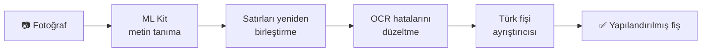
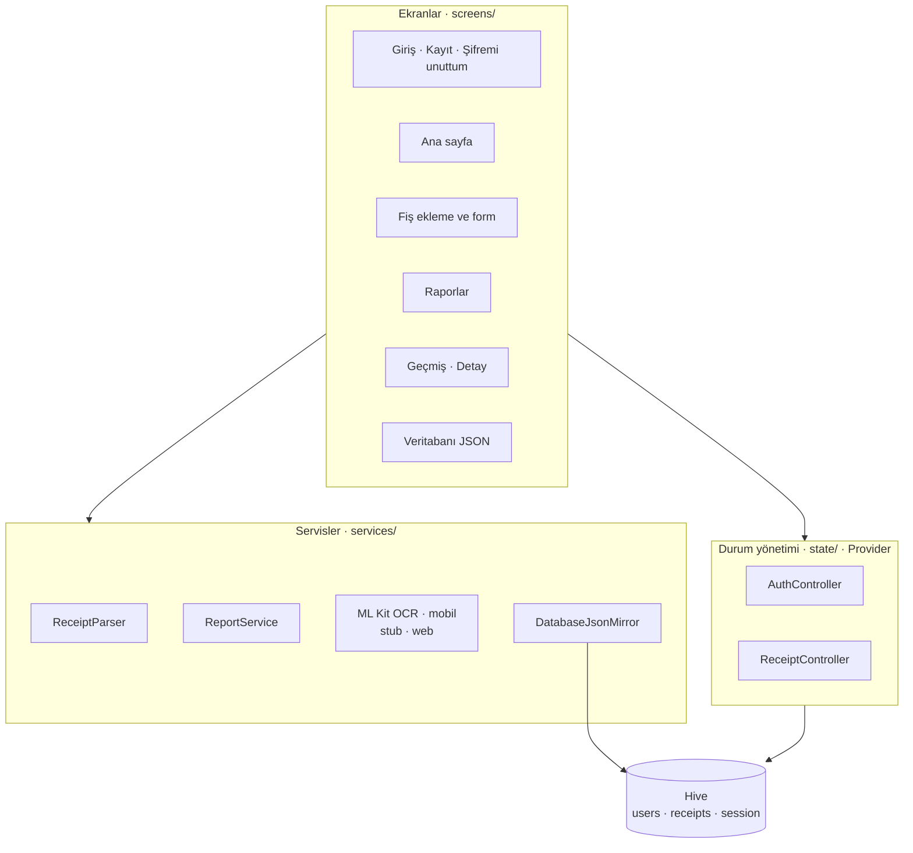

<div align="center">

# 🧾 Fiş Takip

**Fişini okut, harcamanı otomatik takip et.**

Fişin fotoğrafını çekip içindeki ürünleri, tutarları ve KDV'yi otomatik ayrıştıran, harcamaları günlük, haftalık ve aylık raporlayan bir Flutter muhasebe uygulaması.


 &nbsp;
 &nbsp;


</div>

---

## 📑 İçindekiler

1. [Projenin amacı](#-projenin-amacı)
2. [Özellikler](#-özellikler)
3. [Ekran görüntüleri](#-ekran-görüntüleri)
4. [Kullanıcı akışı](#-kullanıcı-akışı)
5. [Fiş okuma nasıl çalışıyor?](#-fiş-okuma-nasıl-çalışıyor)
6. [Raporlama](#-raporlama)
7. [Giriş, kayıt ve şifre sıfırlama](#-giriş-kayıt-ve-şifre-sıfırlama)
8. [Veritabanı ve JSON görünümü](#-veritabanı-ve-json-görünümü)
9. [Mimari](#-mimari)
10. [Kullanılan teknolojiler](#-kullanılan-teknolojiler)
11. [Karşılaşılan sorunlar ve çözümler](#-karşılaşılan-sorunlar-ve-çözümler)
12. [Kurulum ve çalıştırma](#-kurulum-ve-çalıştırma)
13. [Sunum için demo senaryosu](#-sunum-için-demo-senaryosu)
14. [Sınırlamalar ve geliştirme fikirleri](#-sınırlamalar-ve-geliştirme-fikirleri)

---

## 🎯 Projenin amacı

Market, akaryakıt ve kafe gibi yerlerden aldığımız fişler genellikle cüzdanda kaybolur ve ay sonunda paranın nereye gittiği bilinmez. Fişleri tek tek elle deftere veya Excel'e yazmak da zahmetlidir.

**Fiş Takip** bu süreci otomatikleştirir:

1. Kullanıcı **+** butonuna basar ve fişin fotoğrafını çeker.
2. Uygulama fişteki yazıyı **cihazın üzerinde, internet olmadan** okur.
3. Mağazayı, tarihi, ürünleri, adetleri, KDV'yi ve toplamı **otomatik ayırır**.
4. Harcamalar **günlük, haftalık ve aylık raporlara** kategori, mağaza ve ürün bazında işlenir.

---

## ✨ Özellikler

| Alan | Özellik |
|---|---|
| 👤 **Hesap** | Kayıt ol, giriş yap, **Beni hatırla**, **Şifremi unuttum** (6 haneli doğrulama kodu ile) |
| 🏠 **Ana sayfa** | "Merhaba *kullanıcı adı*!" karşılaması, sağ üstte **+** butonu, aylık, haftalık ve günlük özet, kategori dağılımı, son fişler |
| 📷 **Fiş ekleme** | Kamerayla tara · Galeriden seç · Fiş metnini yapıştır · Elle gir |
| 🤖 **Akıllı ayrıştırma** | Mağaza, tarih/saat, fiş no, ürünler, adet (`3 AD X 12,50`), KDV, toplam, ödeme tipi, otomatik **kategori** tahmini |
| ✏️ **Kontrol ekranı** | Okunan her bilgi kaydetmeden önce düzenlenebilir. Ürünlerin toplamı fiş toplamını tutmazsa uyarı çıkar |
| 📊 **Raporlar** | Günlük, haftalık ve aylık dönemler, önceki dönemle karşılaştırma, grafik, kategori pastası, **ürün bazında döküm**, mağazalar |
| 🗂️ **Geçmiş fişler** | Aylara göre gruplama, mağaza veya ürün adıyla arama, kategori filtresi, kaydırarak silme, detay ve düzenleme |
| 🗄️ **Veritabanı görünümü** | Tüm veriler JSON olarak hem uygulama içinde görüntülenir hem telefonda dosyaya yazılır |
| 🎨 **Tasarım** | Material 3, özel renk paleti, Plus Jakarta Sans fontu, açık/koyu tema, Türkçe tarih ve para formatı |

---

## 📱 Ekran görüntüleri

> Tüm görüntüler Android emülatöründe (Pixel 10 Pro) uygulamanın kendisinden alınmıştır.

| Giriş | Şifremi unuttum (doğrulama kodu) | Ana sayfa |
|:---:|:---:|:---:|
|  |  |  |
| **Beni hatırla** ve **Şifremi unuttum** | E-posta servisi yerine kod **sağ üstte bildirim** olarak gelir | "Merhaba kagan!" ve sağ üstte **+** |

| Fiş ekleme (+) | Fotoğraftan okunan fiş | Aylık rapor |
|:---:|:---:|:---:|
|  |  |  |
| 4 farklı ekleme yöntemi | ML Kit ile okunan 5 ürün, adet, kategori ve ödeme | Toplam, ortalama, KDV ve günlük grafik |

| Ürün bazında rapor | Geçmiş fişler | Fiş detayı |
|:---:|:---:|:---:|
|  |  |  |
| Fişlerden ayrıştırılan ürünlerin dökümü | Arama ve kategori filtresi | Ürünler, birim fiyat, KDV, toplam |

| Veritabanı (JSON) |
|:---:|
|  |
| Uygulama içinden veritabanının JSON hâli |

---

## 🔀 Kullanıcı akışı


---

## 🤖 Fiş okuma nasıl çalışıyor?

Okuma, **4 adımlı bir hattan** geçer:



**1. Metin tanıma:** Google ML Kit, fotoğraftaki yazıyı **cihazın üzerinde** okur. İnternet ya da ücretli bir API gerekmez.

**2. Satırları yeniden birleştirme** (`platform_services_io.dart`): ML Kit, fişteki ürün adı sütununu ve fiyat sütununu çoğu zaman **ayrı bloklar** olarak döndürür. Her parçanın ekrandaki dikey konumuna bakılır, aynı hizadakiler birleştirilir ve böylece `EKMEK   *7,50` gibi gerçek fiş satırları elde edilir.

**3. OCR hatalarını düzeltme** (`receipt_parser.dart`): Emülatördeki testlerde ML Kit'in tipik hatalar yaptığı görüldü:

| OCR'ın okuduğu | Gerçeği | Düzeltme kuralı |
|---|---|---|
| `*624,O5` | `*624,05` | Rakamların arasındaki **O harfi → 0** |
| `%O1` | `%01` | `%` işaretinden sonraki O → 0 |
| `*37, 50` | `*37,50` | Ayırıcıdan sonraki boşluk silinir |
| `*24,9` | `*24,90` | `*` ile başlayan tek haneli kuruş tamamlanır |
| `MÍGROS TỈCARET` | `MİGROS TİCARET` | Benzer görünen yabancı harfler (Í, Ỉ, Ő…) Türkçe harfe çevrilir |

> `NO.0045` gibi harften sonra gelen O'lara dokunulmaz. Bu durum için ayrı bir birim testi var.

**4. Türk fişi ayrıştırıcısı:** ÖKC (yazar kasa) fişlerinin düzenine göre şu bilgileri çıkarır:

| Bilgi | Nasıl bulunur? |
|---|---|
| Mağaza | İlk anlamlı satır. Adres, telefon, VKN gibi satırlar atlanır |
| Tarih / saat | `18.10.2026`, `19/10/26`, `SAAT: 18:47` gibi biçimler |
| Ürünler | Sonunda tutar olan satırlar. `TOPLAM`, `KDV`, `NAKİT` gibi kelimeler **tam kelime** olarak elenir, böylece "**KART**ON BARDAK" yanlışlıkla elenmez |
| Adet | Ürünün üstündeki `3 AD X 12,50` veya `0,750 KG X 40,00` satırı |
| Toplam / KDV | `TOPLAM`, `GENEL TOPLAM`, `TOPKDV`. Toplam bulunamazsa ürünlerden hesaplanır |
| İndirim | `İNDİRİM -5,00` negatif kalem olarak eklenir |
| Kategori | Mağaza adındaki anahtar kelimeler: Migros/BİM/ŞOK → Market, Opet/Shell → Akaryakıt, Eczane → Sağlık… |

**Örnek:** Emülatörde okutulan fişin sonucu.

| Fişte yazan | Uygulamanın çıkardığı |
|---|---|
| `MİGROS TİCARET A.Ş.` | Mağaza: **Migros Ticaret A.Ş.** · Kategori: **Market** |
| `TARİH: 18.10.2026  SAAT: 18:47` | Tarih: **18 Ekim 2026, 18:47** |
| `3 AD X 12,50` + `SU 0.5L %01 *37,50` | **Su 0.5L** · 3 adet · ₺37,50 |
| `TOPKDV *35,71` / `TOPLAM *624,05` | KDV **₺35,71** · Toplam **₺624,05** |
| `KREDİ KARTI` | Ödeme: **Kart** |

---

## 📊 Raporlama

`report_service.dart`, kaydedilen fişlerden seçilen dönem için şu raporu üretir:

- **Dönemler:** Günlük (00:00–24:00), Haftalık (pazartesi başlangıçlı), Aylık. Oklarla önceki ve sonraki döneme geçilebilir.
- **Özet:** Toplam harcama, fiş sayısı, ortalama fiş tutarı, toplam KDV ve **önceki döneme göre % değişim**.
- **Grafik:** Günlük raporda 3 saatlik dilimler, haftalıkta haftanın günleri, aylıkta ayın günleri.
- **Kategoriler:** Halka grafik ve yüzdeler.
- **Ürünler:** Fişlerden ayrıştırılan kalemler **birleştirilir**. Örneğin iki ayrı fişteki "Ekmek" tek satırda toplam adet ve tutarla gösterilir.
- **Mağazalar** ve **dönemin fişleri**.

---

## 🔐 Giriş, kayıt ve şifre sıfırlama

| Özellik | Nasıl çalışıyor? |
|---|---|
| **Şifre saklama** | Şifreler düz metin olarak **saklanmaz**. Her kullanıcıya rastgele bir **salt** üretilir ve `SHA-256(salt + şifre)` kaydedilir |
| **Beni hatırla** | İşaretliyse oturum uygulama kapanıp açılınca da sürer ve kullanıcı adı giriş ekranında hazır gelir. İşaretli değilse oturum yalnızca o kullanım süresince açık kalır |
| **Şifremi unuttum** | 1) Kullanıcı adı veya e-posta girilir. 2) `Random.secure()` ile **6 haneli kod** üretilir. 3) Kod girilir. 4) Yeni şifre belirlenir |
| **Kodun gösterimi** | Projede e-posta servisi olmadığı için kod, **ekranın sağ üstünde gelen bir bildirim gibi** gösterilir. Bildirime dokununca kod kopyalanır |
| **Kod güvenliği** | Kod **3 dakika** geçerlidir ve en fazla **5 hatalı deneme** yapılabilir. Yeni kod 30 saniye sonra istenebilir. Ekrandan çıkılınca kod geçersiz olur |

---

## 🗄️ Veritabanı ve JSON görünümü

Veriler cihazda **Hive** ile saklanır: Android'de dosyada, web'de tarayıcının IndexedDB'sinde. Üç tablo (kutu) vardır:

| Kutu | Anahtar | İçerik |
|---|---|---|
| `users` | küçük harf kullanıcı adı | kullanıcı adı, e-posta, şifre özeti, salt, kayıt tarihi |
| `receipts` | fiş id | sahibi, mağaza, tarih, kategori, **ürünler listesi**, toplam, KDV, ödeme, fiş no, görsel yolu, okunan ham metin |
| `session` | `current`, `remembered` | açık oturum ve hatırlanan kullanıcı |

**Veritabanını görmenin 4 yolu:**

1. **Proje klasöründen (editörde canlı):** Uygulama emülatörde açıkken şu komutu çalıştır:
   ```bash
   dart run tool/db_cek.dart --izle
   ```
   Veritabanı `database/fis_takip_db.json` dosyasına kopyalanır. Uygulamada fiş ekledikçe veya sildikçe dosya **2 saniye içinde kendiliğinden güncellenir**, VS Code'da açık tutman yeterli. Tek seferlik kopyalamak için `--izle` yazmadan çalıştır.
   > `database/` klasörü `.gitignore`'dadır. Gerçek kullanıcı verileri repoya gönderilmez.
2. **Uygulama içinden:** Ana sayfada avatar → **Veritabanı (JSON)**. Yenileme ve kopyalama düğmeleri vardır, web'de de çalışır.
3. **Telefondaki dosya:** Her değişiklikte otomatik güncellenir:
   ```
   /sdcard/Android/data/com.kagan.fis_takip/files/fis_takip_db.json
   ```
4. **Repodaki örnek:** [`docs/database_ornek.json`](docs/database_ornek.json)

<details>
<summary><b>Örnek JSON'u göster</b> (kısaltılmış)</summary>

```json
{
  "exportedAt": "2026-10-21T07:26:39.942349",
  "session": { "currentUser": "kagan", "rememberedUser": "kagan" },
  "users": [
    {
      "username": "kagan",
      "email": "kagan@example.test",
      "passwordHash": "afa0f4b457cba77d0e2133829dff4830baf0f4fe026c8d6b7303a788f174d2bf",
      "salt": "Km776f2bFDkV-T9GDJ2Fkw==",
      "createdAt": "2026-10-19T13:20:05.347"
    }
  ],
  "receipts": [
    {
      "id": "1792567507141544817e",
      "owner": "kagan",
      "storeName": "Bim Birleşik Mağazalar A.Ş.",
      "date": "2026-10-19T09:41:00.000",
      "category": "market",
      "items": [
        { "name": "Ekmek", "quantity": 2.0, "total": 30.0 },
        { "name": "Yumurta 10LU", "quantity": 1.0, "total": 79.5 },
        { "name": "Beyaz Peynir", "quantity": 1.0, "total": 145.9 },
        { "name": "Çay 1KG", "quantity": 1.0, "total": 189.0 }
      ],
      "total": 444.4,
      "vat": 35.57,
      "paymentMethod": "Kart",
      "receiptNo": "0127"
    }
  ]
}
```
</details>

---

## 🏗️ Mimari



```
lib/
├── main.dart                     Uygulama girişi, Provider kurulumu
├── theme.dart                    Renk paleti, tipografi, bileşen temaları
├── data/app_database.dart        Hive kutuları
├── models/                       AppUser · Receipt · ReceiptItem · ExpenseCategory
├── state/                        AuthController · ReceiptController
├── services/
│   ├── receipt_parser.dart       Fiş metni → yapılandırılmış veri
│   ├── report_service.dart       Dönem hesapları ve rapor özetleri
│   ├── db_export.dart            Veritabanı → JSON
│   └── platform/                 ML Kit OCR ve dosya işlemleri (mobil) / boş uygulama (web)
├── screens/
│   ├── auth/                     Giriş · Kayıt · Şifremi unuttum
│   ├── home/                     Alt menü · Ana sayfa · Veritabanı
│   ├── receipts/                 Ekleme akışı · Form · Detay · Geçmiş
│   └── reports/                  Raporlar
├── widgets/                      Ortak bileşenler · kayan sekmeler · kod girişi ve bildirimi
└── utils/                        Türkçe metin ve para/tarih biçimlendirme
test/receipt_parser_test.dart     Ayrıştırıcı birim testleri
tool/db_cek.dart                  Cihazdaki veritabanını database/ klasörüne çeker
```

**Tasarım kararları:**
- **Koşullu import:** `platform_services.dart`, mobilde ML Kit'li sürümü, web'de boş sürümü yükler. Böylece aynı kod iki platformda da derlenir.
- **Ayrıştırıcı saf Dart:** Flutter'a veya cihaza bağımlı olmadığı için birim testlerle doğrulanabilir.
- **Kullanıcıya göre veri:** Her fişin `owner` alanı vardır ve her kullanıcı yalnızca kendi fişlerini görür.

---

## 🧰 Kullanılan teknolojiler

| Paket | Ne için? |
|---|---|
| `google_mlkit_text_recognition` | Cihaz üzerinde, internetsiz metin tanıma (OCR) |
| `image_picker` | Kamera ve galeriden fotoğraf seçme |
| `hive_ce` / `hive_ce_flutter` | Hızlı, yerel NoSQL veritabanı (Android ve web) |
| `provider` | Durum yönetimi |
| `fl_chart` | Çubuk ve halka grafikler |
| `crypto` | Şifre özeti (SHA-256) |
| `intl` + `flutter_localizations` | Türkçe tarih (`18 Ekim 2026`) ve para (`₺1.068,45`) biçimi |
| `path_provider` | Fiş görselleri ve JSON dosyası için klasörler |
| Plus Jakarta Sans | Türkçe karakter destekli font, uygulamaya gömülü |

---

## 🧩 Karşılaşılan sorunlar ve çözümler

| Sorun | Çözüm |
|---|---|
| ML Kit fişteki ürün adlarını ve fiyatları ayrı sütunlar olarak döndürdü | Satırlar ekrandaki konumlarına göre yeniden birleştirildi |
| İlk denemede 5 üründen 2'si ve toplam okunamadı (`624,O5`, `24,9`) | OCR düzeltme adımı eklendi. Gerçek OCR çıktısı birim testine çevrildi ve artık 5/5 ürün okunuyor |
| "TELEFON", "KARTON" gibi ürünler `TEL` / `KART` anahtar kelimeleri yüzünden eleniyordu | Anahtar kelimeler **tam kelime** olarak aranıyor |
| Dart'ın `toUpperCase` fonksiyonu Türkçe I/İ dönüşümünü bilmiyor | Türkçeye özel `trUpper`, `trLower` ve `trTitleCase` yazıldı |
| Android derlemesi eksik NDK yüzünden başarısız oldu | Gerekli NDK sürümü kuruldu |
| Web'de doğrulama kodu kutularına yazı girilemiyordu | Görünmez alan `Opacity(0)` yerine şeffaf yazıyla çizildi |
| Klavyedeki "ileri" tuşu bir sonraki alan yerine şifre göster/gizle butonuna atlıyordu | Buton odak sırasından çıkarıldı (`ExcludeFocus`) |

---

## 🚀 Kurulum ve çalıştırma

```bash
git clone https://github.com/auxydev/flutter_odev.git
cd flutter_odev
flutter pub get
```

```bash
flutter run                 # bağlı Android cihaz veya emülatör
flutter run -d chrome       # web (fotoğraftan okuma hariç)
flutter test                # ayrıştırıcı birim testleri
```

> 📷 Fotoğraftan fiş okuma **Android ve iOS**'ta çalışır. Web'de **"Fiş metnini yapıştır"** (içinde *Örnek fiş doldur* butonu var) ve **"Elle gir"** kullanılabilir.

**Test hesabı:** kullanıcı adı `kagan`, şifre `deneme123`. Veriler yalnızca cihazda saklanır.

---

## 🎤 Sunum için demo senaryosu

1. **Kayıt / giriş:** Yeni bir hesap aç ve "Merhaba *kullanıcı adı*!" karşılamasını göster.
2. **Şifremi unuttum:** Çıkış yap, *Şifremi unuttum*'a gir, kullanıcı adını yaz. Kodun **sağ üstte** geldiğini göster, kodu girip yeni şifre belirle ve yeni şifreyle giriş yap.
3. **Fiş okutma:** **+** → *Galeriden seç* ile fişi seç. Ürünlerin, adetlerin ve toplamın otomatik dolduğunu göster, ardından kaydet.
4. **Web alternatifi:** **+** → *Fiş metnini yapıştır* → *Örnek fiş doldur* → *Ayrıştır*.
5. **Raporlar:** *Günlük → Haftalık → Aylık* arasında geç, grafiği ve **ürün bazında dökümü** göster.
6. **Geçmiş fişler:** Ürün adıyla ara (ör. "ekmek"), kategori filtresini kullan, bir fişin detayını aç.
7. **Veritabanı:** Avatar → *Veritabanı (JSON)*. Şifrelerin özet (hash) olarak saklandığını göster.

---

## 🔭 Sınırlamalar ve geliştirme fikirleri

- Veriler yalnızca cihazda tutuluyor. **Firebase** ile bulut eşitleme ve birden fazla cihaz desteği eklenebilir.
- Şifre sıfırlama kodu ekranda gösteriliyor. Gerçek bir **e-posta/SMS servisi** ile gönderilebilir.
- Şifreler için SHA-256 yerine **PBKDF2 / Argon2** gibi yavaş özet fonksiyonları kullanılabilir.
- Buruşuk veya eğik fişlerde okuma doğruluğu düşebilir. Bu yüzden kaydetmeden önce **kontrol ekranı** var.
- Aylık **bütçe limiti** ve aşım bildirimleri, **Excel/PDF dışa aktarma** eklenebilir.
